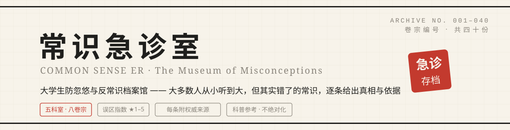
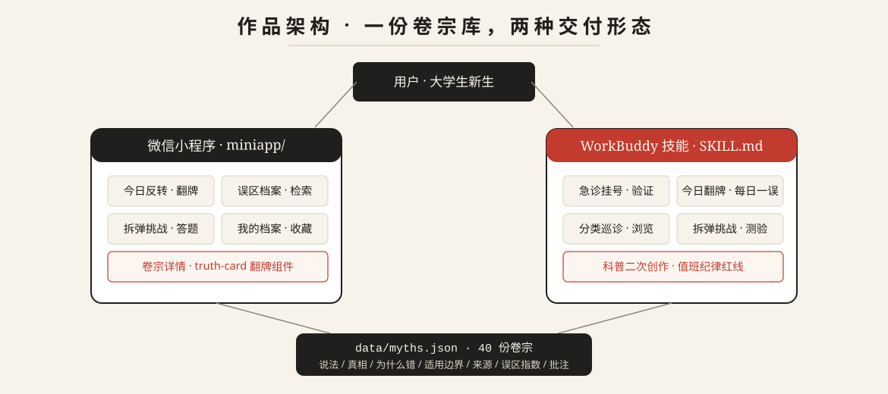

<p align="center">
  
</p>

<p align="center">
  <a href="LICENSE"></a>
  
  
  
  
  
</p>

> **一条常识，可能骗了你很久。**
> 我们把「大多数中国人从小听到大、但其实错了」的常识做成编号卷宗，
> 逐条给出：流传说法 → 真相结论 → 为什么错 → 适用边界 → 权威来源 → 误区指数。

---

## 为什么做这件事

大学新生刚脱离中学的信息环境，就被家族群的养生偏方、社交平台的伪科学与校园里口口相传的错误经验包围。市面上的辟谣内容要么情绪化、要么碎片化，**很少有产品愿意像档案馆一样，把每一条「为什么错」讲得有据、有边界、有分寸**。

「常识急诊室」就是为此而建：40 份编号卷宗，冷静克制、可翻卡、可答题、可收藏、可分享——像逛一座知识博物馆，而不是看一篇震惊体推文。

## 三张展签

| 卷宗严谨 | 双形态交付 | 可复现 Demo |
| :--- | :--- | :--- |
| 每条结论不绝对化，标注适用条件；健康条目附「科普参考，不构成医疗建议」 | 同一份 40 卷宗数据，同时驱动 **微信小程序** 与 **WorkBuddy 智能体技能** | 导入微信开发者工具即跑；技能包复制进 `~/.workbuddy/skills/` 即用，零后端零接口 |

## 金句摘录（档案馆展签）

> 「水没变坏，变坏的是想象力。」
> 「味精不背这个锅。」
> 「它只是活得比较坚强。」
> 「长城很长，但没长到太空。」

## 五大科室 · 数据一览

| 科室 | 卷宗数 | 误区指数跨度 | 卷宗示例 | 权威来源举例 |
| :--- | :---: | :---: | :--- | :--- |
| 饮食健康 | 8 | ★★–★★★★★ | 骨头汤补钙 · 菠菜补铁 · 隔夜菜致癌 | GB 标准 · 《中国居民膳食指南》 |
| 校园生活 | 8 | ★★–★★★★ | 不挂科不完整 · 刷单兼职 · 插线板串接 | 国家反诈中心 · 消防规范 |
| 生活物理 | 8 | ★★★–★★★★★ | 公牛见红 · 高铁辐射 · 电梯下坠起跳 | IARC · 物理教学参考 |
| 动物植物 | 8 | ★★★–★★★★ | 金鱼 7 秒记忆 · 鸵鸟埋沙 · 仙人掌防辐射 | 《中国植物志》· 动物学研究 |
| 历史文化 | 8 | ★★★–★★★★★ | 拿破仑矮 · 爱因斯坦不及格 · 七月流火 | 《三国志》裴注 · 《现代汉语词典》 |

完整 40 条索引见 [`docs/数据索引.md`](docs/数据索引.md)。

## 作品架构

<p align="center">
  
</p>

一份数据，两种形态：

- **微信小程序**（`miniapp/`，原生 JS + WXML + WXSS）：今日反转（3D 翻牌）· 误区档案（筛选/搜索/排序）· 拆弹挑战（真讹平衡 5 题）· 我的档案（收藏/战绩）· 卷宗详情（真相卡翻面 + 相关误区）
- **WorkBuddy 技能**（`SKILL.md`）：让 AI 智能体化身「急诊值班主任」，支持说法验证、每日一误、分类巡诊、拆弹挑战、科普二次创作五种工作流，内置值班纪律红线

## 快速开始

```bash
git clone https://github.com/S0915-yh/changshi-jizhenshi.git
```

**① 运行小程序**：打开微信开发者工具 → 导入项目 → 选择 `miniapp/` 目录（AppID 可用测试号）→ 编译即跑。无后端、无付费接口，收藏与进度存本地。

**② 使用技能包**：将整个 `changshi-jizhenshi` 文件夹复制到 `~/.workbuddy/skills/`，开启新会话对 WorkBuddy 说：

> 「听说喝骨头汤补钙，是真的吗？」——智能体会先查卷宗库，再开出「急诊病历卡」。

## 目录结构

```
changshi-jizhenshi/
├── SKILL.md                 # 技能入口：触发词、五种工作流、值班纪律
├── data/myths.json          # 40 份卷宗 · 核心数据（10 字段）
├── miniapp/                 # 微信小程序（34 个文件）
│   ├── app.js / app.json / app.wxss / sitemap.json
│   ├── pages/  index · archive · detail · quiz · mine
│   ├── components/truth-card/   # 3D 翻牌真相卡组件
│   └── utils/  data · daily（按日期稳定选题）· storage · feedback
├── docs/
│   ├── 作品说明文档.md       # 参赛说明（866 字）
│   ├── 小程序设计说明.md     # 产品设计 · 视觉 token · 信息架构
│   ├── 验收清单.md           # 对照验收标准逐项自查
│   ├── 演示旁白脚本.md       # 3 分钟路演脚本
│   └── 数据索引.md           # 40 条卷宗索引
├── references/查证路径.md    # 未命中卷宗时的权威查证入口
└── assets/                  # banner.svg · architecture.svg（纯矢量，无版权风险）
```

## 参赛文档

- [作品说明文档](docs/作品说明文档.md) — 真实问题 · 创意思路 · AI 赋能流程 · 应用效果
- [小程序设计说明](docs/小程序设计说明.md) — 设计关键词 · 视觉 token · 信息架构 · 交互规范
- [验收清单](docs/验收清单.md) — 逐项对照大赛验收标准
- [演示旁白脚本](docs/演示旁白脚本.md) — 适配路演录屏
- [数据索引](docs/数据索引.md) — 40 份卷宗完整清单

## 原创性与合规声明

- 40 条卷宗内容为**原创编写**，未复制任何现有技能、图书或课程文本；误传说法本身属公共文化常识，真相表述与档案结构为原创。
- 每条 `sourceName` 均指向真实存在的公开标准、指南、词典、学术出版物或权威机构，未虚构任何出处。
- 表述遵循审慎原则：不绝对化、不涉政治宗教敏感、医学内容仅作科普并提示遵医嘱。

## License

MIT
